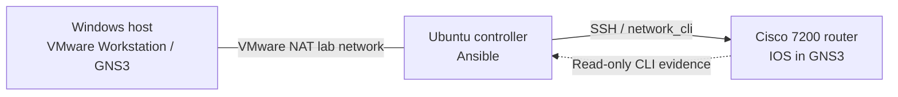
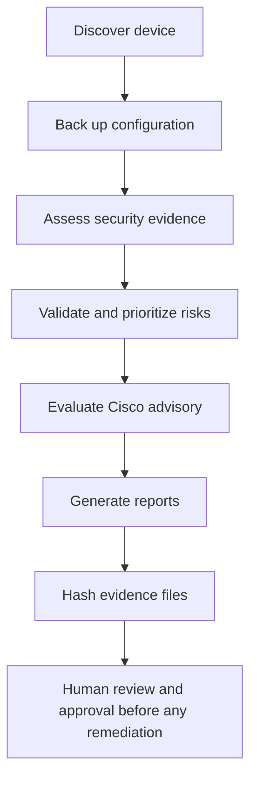

# Governed Network Security Assessment with Ansible

**Cisco IOS · GNS3 · Ansible · Risk Assessment · Evidence Integrity**

A hands-on network automation lab by **Ayoub Afi**. The project uses Ansible to connect to a Cisco IOS router in GNS3, collect configuration and operational evidence, document security findings, assess the applicability of a Cisco field notice, and generate local reports and SHA-256 evidence manifests.

> **Current scope:** Read-only network assessment and configuration backup. This project does **not** install IOS patches, change router configuration, or automatically approve remediation.

## What the lab demonstrates

- **Discovery:** Collect the IOS version and interface status.
- **Backup:** Save timestamped running-configuration snapshots on the Ansible controller.
- **Security assessment:** Inspect software, interfaces, SSH status, and routing information.
- **Risk management:** Maintain a structured risk register with validated scoring inputs and explicit approval status.
- **Advisory review:** Check technical prerequisites for Cisco Field Notice **FN70489**.
- **Evidence integrity:** Record SHA-256 checksums of generated backups and reports.

## Lab topology



The Ansible controller and GNS3 router communicate over an isolated virtual lab network. Replace all example management addresses with addresses from your own environment.

## Technology

| Component | Lab implementation |
| --- | --- |
| Automation controller | Ubuntu Server 24.04, Ansible Core 2.16.3 |
| Simulated device | Cisco 7200, IOS 15.3(3)XB12 |
| Network simulator | GNS3 with VMware Workstation |
| Device access | SSH using `ansible.netcommon.network_cli` and `cisco.ios.ios` |
| Cisco modules | `cisco.ios.ios_command` |
| Evidence | Markdown reports, configuration backups, SHA-256 manifests |

**Compatibility note:** The router uses legacy SSH cryptography. The lab used Paramiko for compatibility; this should not be treated as a recommended configuration for production equipment.

## Assessment workflow



No change or deployment stage is implemented. The final approval step is a governance requirement, not an automated approval action.

## Project structure

```text
.
├── inventory.ini
├── site.yml                    # Main assessment orchestration
├── discover.yml                # Inventory discovery and backup
├── assess.yml                  # IOS and SSH security assessment
├── risk_assessment.yml        # Risk input validation and priority
├── advisory_assessment.yml    # Cisco FN70489 applicability review
├── manifest.yml               # Evidence SHA-256 manifest
├── vars/
│   ├── risks.yml
│   └── advisories.yml
├── templates/
│   ├── assessment.md.j2
│   ├── risk_register.md.j2
│   ├── advisory_report.md.j2
│   └── manifest.md.j2
├── backups/                    # Generated; do not commit
├── reports/                    # Generated; do not commit
└── manifests/                  # Generated; do not commit
```

**Important:** In the original lab export, `site.yml` imports `discover.yml`, `assess.yml`, `risk_assessment.yml`, and `advisory_assessment.yml`. The manifest playbook runs **separately** unless you add `- import_playbook: manifest.yml` to the end of `site.yml`.

## Getting started

### 1. Requirements

- A reachable Cisco IOS lab device with SSH configured.
- A Linux Ansible controller with compatible Python and SSH dependencies.
- Ansible collections `cisco.ios` and `ansible.netcommon`.
- An SSH account permitted to run the necessary IOS `show` commands.

Check the installation:

```bash
ansible --version
ansible-galaxy collection list
```

### 2. Configure the inventory

Edit `inventory.ini` for your lab. For example:

```ini
[cisco_routers]
R1 ansible_host=192.0.2.10

[cisco_routers:vars]
ansible_user=ansible
ansible_connection=ansible.netcommon.network_cli
ansible_network_os=cisco.ios.ios
ansible_network_cli_ssh_type=paramiko
```

`192.0.2.10` is a **documentation-only example IP**, not a working address. Replace it with the address of your own router. Do not commit passwords or private credentials.

### 3. Test device access

```bash
ansible cisco_routers -i inventory.ini \
  -m cisco.ios.ios_command \
  -a '{"commands": ["show version"]}' \
  --ask-pass
```

### 4. Run the assessment

Validate syntax first:

```bash
ansible-playbook -i inventory.ini site.yml --syntax-check
ansible-playbook -i inventory.ini site.yml --list-tasks
```

Run the configured assessment workflow:

```bash
ansible-playbook -i inventory.ini site.yml --ask-pass
```

Generate an evidence manifest after reports are available:

```bash
ansible-playbook -i inventory.ini manifest.yml
```

To automatically generate the manifest as the final step, append this line to `site.yml`:

```yaml
- import_playbook: manifest.yml
```

Then rerun the syntax check and main playbook.

## Example findings from the lab

| ID | Observation | Assessment |
| --- | --- | --- |
| F01 | Legacy Cisco IOS 15.3(3)XB12 | Requires software support and advisory review |
| F02 | SSH required legacy SHA-1 key exchange and CBC ciphers | Confirmed legacy cryptography; modernization recommended |
| FN70489 | Affected release string matched, but no PKI trustpoint was configured | Preliminary result: `NOT_APPLICABLE` in this lab configuration |

The FN70489 result is **configuration-specific**. It does not mean the IOS version is free from vulnerabilities, and a Cisco Field Notice is not equivalent to a complete CVE assessment.

## Risk scoring and governance

The risk register supports four assessment factors—**impact, exposure, likelihood, and criticality**—each entered as an integer from 1 to 5. Their sum gives an internal prioritization score from 4 to 20. The project explicitly labels incomplete assessments **NOT ASSESSED** rather than assigning a misleading low-risk score.

This is a **custom lab prioritization model, not CVSS**. Current findings have incomplete scoring fields and `approved: false`. Manual ownership assignment, evidence review, approval, and a separate remediation plan are still required.

## Evidence and limitations

- Configuration backups are saved on the controller with restrictive file permissions.
- Reports document observed state and assessment results.
- `manifest.yml` computes SHA-256 hashes of backup and report files to make later file changes detectable **when compared with a trusted baseline**.
- A checksum manifest is **not a digital signature**, independent proof of authorship, or a tamper-proof audit system.
- The existing manifest inventories files present at execution time; it does not yet associate every file with a single immutable run ID.
- Some generated report filenames are timestamped; other reports are replaced when the workflow is rerun.
- No automated patch installation, restore procedure, production change approval, or full vulnerability feed correlation is implemented.

## Repository safety

Do **not** commit generated configuration backups, reports, manifests, passwords, private keys, or real infrastructure details. A suggested `.gitignore`:

```gitignore
backups/
reports/
manifests/
.env
*.pem
*.key
vault-password*
*.retry
__pycache__/
*.pyc
```

If committing `inventory.ini`, replace the real lab IP and account details with sanitized examples first, or instead publish `inventory.example.ini` and ignore the real inventory.

## Next milestones

1. Add a unique run ID so each assessment links to its exact reports, backup, and manifest.
2. Add integrity verification that compares current evidence against a protected earlier manifest.
3. Enrich risk findings with authoritative vendor security advisories and lifecycle data.
4. Document accountable reviewers, maintenance windows, and simulation/rollback procedures.
5. Develop a **separate, explicitly approved** patch or image-upgrade workflow after compatibility and recovery validation.

## References

- [Ansible: Cisco IOS command module](https://docs.ansible.com/ansible/latest/collections/cisco/ios/ios_command_module.html)
- [Ansible: Importing playbooks](https://docs.ansible.com/ansible/latest/collections/ansible/builtin/import_playbook_module.html)
- [Ansible: File checksums with `stat`](https://docs.ansible.com/ansible-core/2.16/collections/ansible/builtin/stat_module.html)
- [Cisco Field Notice FN70489](https://www.cisco.com/c/en/us/support/docs/field-notices/704/fn70489.html)
- [Cisco Software Checker](https://sec.cloudapps.cisco.com/security/center/softwarechecker.x)

---

**Author:** Ayoub Afi  
**Focus:** Network engineering · Security assessment · Ansible automation · Governed operations
